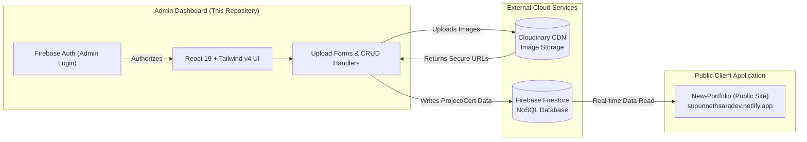

# 🎛️ Portfolio CMS & Admin Dashboard

<div align="center">

  [](https://react.dev/)
  [](https://vitejs.dev/)
  [](https://tailwindcss.com/)
  [](https://firebase.google.com/)
  [](https://cloudinary.com/)
  [](LICENSE)

  <p align="center">
    A secure, modern Content Management System (CMS) and Administrative Dashboard built for <a href="https://github.com/SupunNethsara/New-Portfolio"><strong>Supun Dharmathilaka's Developer Portfolio</strong></a>. Provides full CRUD capabilities, real-time Firestore analytics, Cloudinary asset pipelines, and Firebase authentication.
  </p>

  <p align="center">
    <a href="#-key-features">Key Features</a> •
    <a href="#-system-architecture">Architecture</a> •
    <a href="#-tech-stack">Tech Stack</a> •
    <a href="#-project-structure">Project Structure</a> •
    <a href="#-getting-started">Getting Started</a> •
    <a href="#-author--contact">Author</a>
  </p>

</div>

---

## 🌟 Overview

The **Portfolio Admin Panel** is the operational backend command center for Supun Dharmathilaka's online portfolio. Rather than relying on hardcoded static data or redeploying code for every update, this dashboard provides dynamic management of projects, certifications, technical badges, licenses, and media assets in real time via **Firebase Firestore** and **Cloudinary**.

---

## ✨ Key Features

- **🔐 Secure Role-Gated Authentication**:
  - Firebase Authentication (`onAuthStateChanged`) with automatic session persistence and redirect guards on all private dashboard routes.
- **💼 Comprehensive Project Management (CRUD)**:
  - Create, view, edit, and delete portfolio project records.
  - Multi-image upload pipeline powered by Cloudinary with real-time percentage upload progress indicators.
  - Tagging system for technologies (React, Node, Laravel, Tailwind, Python, etc.) with custom tag addition.
  - Configurable metadata: visibility status, company vs personal project flags, repository and live demo links, project timeline/duration, and deep-dive markdown descriptions.
- **📜 Certifications & Credentials Management**:
  - Add, edit, and categorize course completion certificates and technical certifications.
  - Upload credentials with issuing organization, date, and verifiable credential URLs.
- **🏛️ License Certificates Management**:
  - Dedicated module for official academic diplomas (DIT, HNDIT, BIT) and organizational licenses.
- **📊 Real-time Dashboard Analytics**:
  - Live metric count cards aggregating total projects, certificates, and licenses directly from Firestore server counts (`getCountFromServer`).
  - Quick action shortcuts for instant asset uploading.
- **🎨 Modern Glassmorphism & Micro-Interactions**:
  - Designed with Tailwind CSS v4, dynamic gradients, smooth hover elevations, and responsive sidebar navigation.

---

## 🏛️ System Architecture



---

## 🛠️ Tech Stack

| Domain | Technology | Description |
| :--- | :--- | :--- |
| **Frontend Framework** | **React 19** | Component-driven declarative UI architecture |
| **Build Tool** | **Vite 7 (SWC)** | High-speed compiler and development server with React SWC plugin |
| **Styling** | **Tailwind CSS v4** | Modern zero-runtime utility-first design framework |
| **Routing** | **React Router DOM v7** | Nested routing with protected authentication boundaries |
| **Database & Auth** | **Firebase 12** | Firestore NoSQL Real-time database & Authentication |
| **Media Hosting** | **Cloudinary API** | Automated cloud image hosting, optimization, and transformation |
| **HTTP Client** | **Axios** | RESTful network requests and API communication |
| **Icons** | **React Icons** | Comprehensive feather and font-awesome iconography |

---

## 📁 Project Structure

```text
Admin-panel-of-my-portfolio/
├── src/
│   ├── App.jsx                                  # Protected routes & auth state listener
│   ├── main.jsx                                 # Application entry point
│   ├── firebaseConfig.js                        # Firebase app & Firestore initialization
│   ├── Cloudinaryapi.js                         # Direct unsigned/signed image upload helper
│   └── Components/
│       ├── Main Components/
│       │   ├── Login.jsx                        # Admin sign-in screen
│       │   ├── Dashboard.jsx                    # Dashboard layout container & sidebar
│       │   ├── DashboardHome.jsx                # Analytics cards & quick actions
│       │   ├── Projects/
│       │   │   ├── ProjectsList.jsx             # All projects tabular view & delete trigger
│       │   │   ├── projectUploadForm.jsx        # Project creation form with Cloudinary upload
│       │   │   └── ProjectEditForm.jsx          # Project update form
│       │   └── Certificates/
│       │       ├── CertificatesList.jsx         # Course certificates table
│       │       ├── Certificates.jsx             # Add new certificate form
│       │       ├── CertificateEditForm.jsx      # Edit certificate details
│       │       ├── LicenseCertificatesList.jsx  # Academic & license credentials list
│       │       ├── LicenseCerificate.jsx        # Add license credential form
│       │       └── LicenseCertificateEditForm.jsx
│       └── Shared/                              # Reusable buttons, modals, & alerts
├── package.json                                 # Dependencies & scripts
└── vite.config.js                               # Vite configuration with Tailwind & SWC
```

---

## 🚀 Getting Started

### Prerequisites

- **Node.js**: v18.0.0 or higher ([Download Node.js](https://nodejs.org/))
- **Firebase Project**: An active Firebase project with Authentication (Email/Password) and Cloud Firestore enabled.
- **Cloudinary Account**: Cloud name and unsigned upload preset configured for media uploads.

### Installation

1. **Clone the repository**:
   ```bash
   git clone https://github.com/SupunNethsara/Admin-panel-of-my-portfolio.git
   cd Admin-panel-of-my-portfolio
   ```

2. **Install dependencies**:
   ```bash
   npm install
   ```

3. **Configure Environment / Firebase Credentials**:
   Verify or supply your Firebase configuration in [src/firebaseConfig.js](src/firebaseConfig.js) and Cloudinary upload credentials in [src/Components/Main Components/Cloudinaryapi.js](src/Components/Main%20Components/Cloudinaryapi.js).

4. **Launch development server**:
   ```bash
   npm run dev
   ```
   Open `http://localhost:5173` in your browser.

---

## 📜 Available Scripts

| Command | Description |
| :--- | :--- |
| `npm run dev` | Starts the Vite development server with SWC fast refresh |
| `npm run build` | Compiles and optimizes assets into production `dist/` bundle |
| `npm run preview` | Locally tests and previews the production build |
| `npm run lint` | Analyzes code with ESLint for syntax and quality errors |

---

## 👨‍💻 Author & Connect

**Supun Dharmathilaka (Supun Nethsara)**  
*Associate Team Lead Software Engineer & Full Stack Developer*

- 🌐 **Portfolio**: [supunnethsaradev.netlify.app](https://supunnethsaradev.netlify.app/)
- 💼 **LinkedIn**: [linkedin.com/in/supun-dharmathilaka](https://www.linkedin.com/in/supun-dharmathilaka-a64389257/)
- 🐙 **GitHub**: [@SupunNethsara](https://github.com/SupunNethsara)
- 📧 **Email**: [supundarmathilaka@gmail.com](mailto:supundarmathilaka@gmail.com)

---

## 📄 License

This project is licensed under the [MIT License](LICENSE).
